# Illustrative Toy Examples
Various small-scale demonstrations of EVON, shown in the paper in Fig. 1, Fig. 3 and Fig. 4.  

## demo_2d.py
This script compares on a simple 2d logistic regression problem the following methods: 
* EVON's posterior (with and without whitening)
* IVON's diagonal posterior
* The MAP solution found by SGD. 
* A full covariance Gaussian posterior approximation found by the Variational Online Newton (VON) method 

All Gaussian posteriors are visualized as ellipses. 

Expected output of `uv run demo_2d.py` (with `EVON_WHITENING=True` and `RUN_VON=False`)

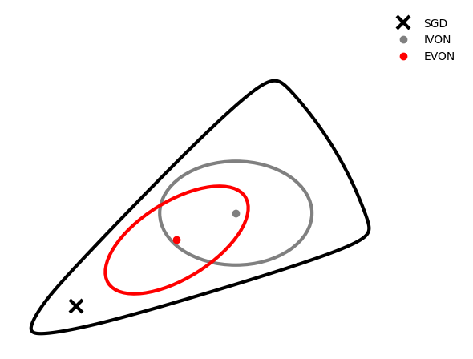

This is used to make Fig.1a in the paper. 

Expected output of `uv run demo_2d.py` (with `EVON_WHITENING=False` and `RUN_VON=True`). 

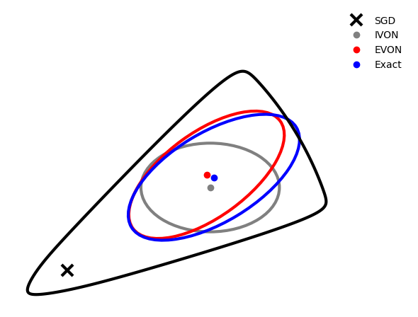 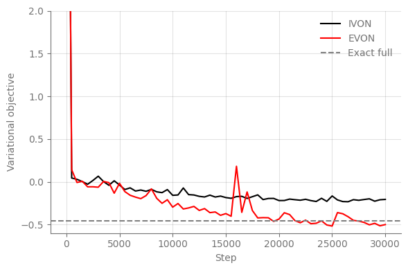

We find that EVON matches the exact Gaussian posterior found by full-Gaussian VON, except for some smaller differences likely due to the stochastic optimization.

## demo_hmc.py 
This computes exact posterior marginals for multiclass Bayesian logistic regression on the Iris dataset, and compares them to IVON and EVON's marginals. This is Fig. 4(b) in the paper. 

Expected output of `uv run demo_hmc.py`.   

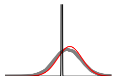
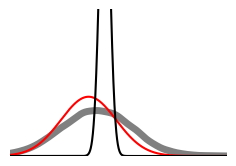
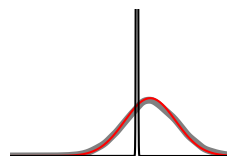
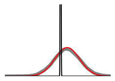
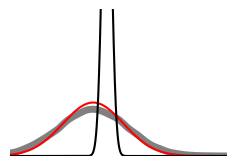
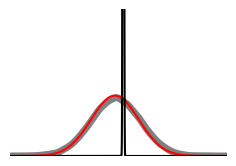
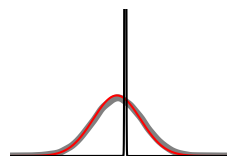
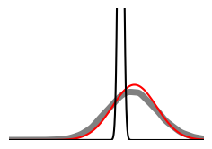
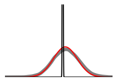
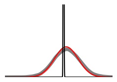
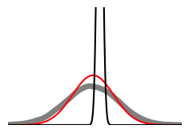
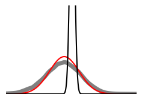
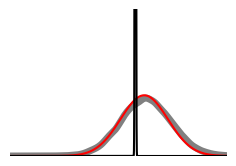
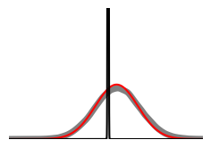

Negative ELBO convergence: 
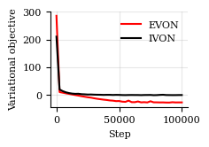

## demo_inbetween.py
Trains a small and a larger MLP with both IVON and EVON on a simple 1D regression dataset. Visualizes the posterior uncertainty. 

Expected output of `uv run demo_hmc.py`. 

Small Tanh-MLP, EVON (left) vs IVON (right)  
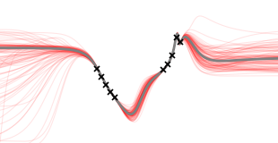
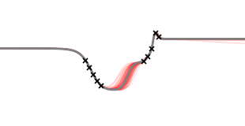

Big ELU-MLP, EVON (left) vs IVON (right)   
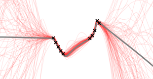
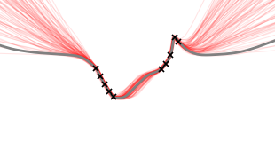

## demo_logreg.py
Bayesian logistic regression on a binary digit classification dataset (USPS 3vs5). Compares the exact posterior (found via piecewise bound and L-BFGS) to SLANG, IVON and EVON's posterior. 

Expected output of `uv run demo_logreg.py`.   
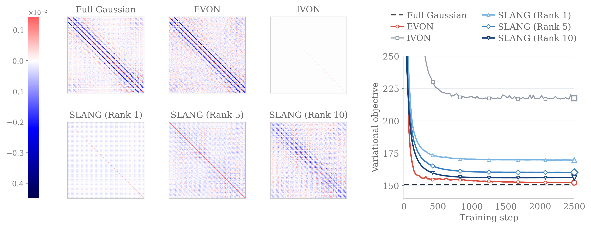

